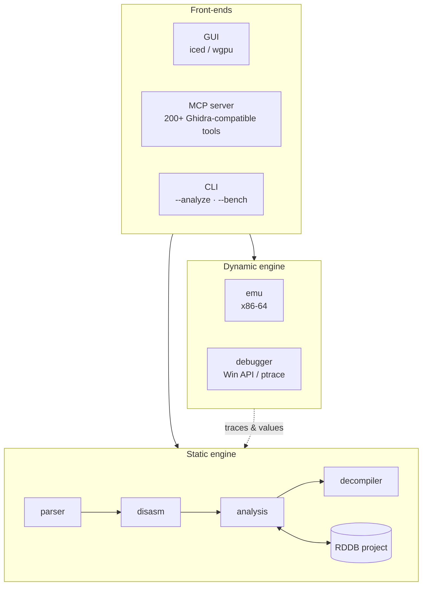

<div align="center">

<!--  -->

# rust-debugger

### Ghidra / IDA-style reverse engineering — written in Rust

Static analysis, pcode decompilation, live debugging and an x86-64 emulator<br/>
in one fast, self-contained workbench — with a GPU-accelerated GUI<br/>
and a **Ghidra-compatible MCP server** for AI agents.

<br/>

[](LICENSE)
[](https://www.rust-lang.org/)
[](#requirements)
[](#mcp-server-for-ai-agents)
[](#)

[](#contributing)

<!-- Dynamic GitHub badges (shields.io) fetch private repos anonymously → they break.
     Re-enable when the repository goes public:
[](https://github.com/jaszkus/rust-debugger/stargazers)
[](https://github.com/jaszkus/rust-debugger/issues)
[](https://github.com/jaszkus/rust-debugger/commits)
-->

<br/>

[**Features**](#features) ·
[**Quick start**](#quick-start) ·
[**CLI**](#command-line) ·
[**MCP server**](#mcp-server-for-ai-agents) ·
[**Architecture**](#architecture) ·
[**Contributing**](#contributing)

</div>

<br/>

> [!WARNING]
> **Under active development (`0.1.0`).** Features, APIs and project-file formats may change.
> **I'm actively looking for contributors** — see [Contributing](#contributing).

<!--
   ADD A SCREENSHOT OR GIF HERE — it's the single biggest boost for a README.
  <p align="center">
    
  </p>
-->

---

## Why rust-debugger?

| | |
| --- | --- |
|  **All-in-one** | Loader, disassembler, analyzer, decompiler, emulator and debugger in a single native binary. |
|  **Built for AI agents** | 200+ **Ghidra-compatible** MCP tool names — existing Ghidra-MCP clients and prompts work out of the box. |
|  **Fast & headless-friendly** | Batch `--analyze` and `--serve` modes need no GPU; analysis results are cached in compressed project files. |
|  **Modern GUI** | GPU-accelerated front-end on `iced` / `wgpu` (Vulkan, DX12 or Metal). |
|  **Static + dynamic** | Go from disassembly to decompiled C-like code, then step through it live or dry-run it in the emulator. |

### At a glance

| Formats | Architectures | Debugging | Platforms | MCP tools |
| :---: | :---: | :---: | :---: | :---: |
| PE · ELF · Mach-O · .NET · minidump · map | x86 · x86-64 · ARM64 | Win32 Debug API · `ptrace` | Windows · Linux | **200+** |

---

## Features

<table>
<tr>
<td width="50%" valign="top">

### Parsing & loading
- **PE, ELF, Mach-O**, **.NET** (CLR metadata), **minidump** and linker **map files**
- **DWARF** (via `gimli`) and **PDB** debug info
- C++ / Rust symbol **demangling**
- RTTI scan, resources, imports / exports, sections

</td>
<td width="50%" valign="top">

### Disassembly
- **x86 / x86-64** via [`iced-x86`](https://github.com/icedland/iced)
- **ARM64** via [`yaxpeax-arm`](https://github.com/iximeow/yaxpeax-arm)
- Built-in **x86 assembler / encoder** used for patching

</td>
</tr>
<tr>
<td width="50%" valign="top">

### Analysis pipeline
- Function detection (entries, thunks, call / jump targets) and **FID signatures**
- **CFG**, constant propagation, noreturn inference, stack / unwind and variable recovery
- Cross-references, import xrefs, **string extraction** with an n-gram classification model
- Detection passes: **packers, anti-debug, obfuscation, crypto**, .NET, Go, ObjC

</td>
<td width="50%" valign="top">

### Decompiler
- x86-64 → **pcode** lifting
- Mini-**SSA** expression trees
- **C-like** output with recovered variables

</td>
</tr>
<tr>
<td width="50%" valign="top">

### Emulation & live debugging
- **x86-64 emulator** (ALU, flags, memory) for deobfuscation and dry-running functions
- Live debugging through **Windows Debug API / Linux `ptrace`**
- Breakpoints, stepping, registers & memory, threads, stack traces, **recorded traces**

</td>
<td width="50%" valign="top">

### Patching & projects
- Byte and **branch patching** with history and rebuild-after-patch
- **RDDB v4 / v5** project files — zstd-compressed analysis cache + annotations

</td>
</tr>
<tr>
<td colspan="2" valign="top">

### GUI
Listing · Hex · Decompiler · Pcode · CFG · Xrefs · Strings · Symbols · Stack · Sections · Imports · Resources · Patches · Debug · Live

</td>
</tr>
</table>

---

## Requirements

- **Rust** stable toolchain (edition 2021)
- **Windows 10+** or **Linux** (Wayland / X11)
- A GPU with **Vulkan, DX12 or Metal** support for the GUI

> [!TIP]
> Headless `--serve` and `--analyze` runs need **no GPU** — perfect for servers, CI and containers.

---

## Quick start

```sh
git clone https://github.com/jaszkus/rust-debugger.git
cd rust-debugger
cargo build --release
```

The binary lands in `target/release/rust-debugger`.

```sh
rust-debugger                 # open an empty workbench
rust-debugger sample.exe      # open a binary straight away
```

---

## Command line

| Command | Description |
| --- | --- |
| `rust-debugger [file]` | Launch the GUI, optionally preloading a file |
| `rust-debugger --serve [port] [file]` | Headless MCP server (alias `--headless`). Default port `7777`, `0` picks a free one |
| `rust-debugger --analyze <file> [--fresh]` | Batch parse + disasm + analyze and print a JSON summary (RDDB-cached; `--fresh` ignores the cache) |
| `rust-debugger --bench <file> [--parse-only]` | Time the parse / disasm / analysis phases |
| `rust-debugger --version`, `--help` | Version / usage |

<details>
<summary><b>Environment variables & exit codes</b></summary>

<br/>

| Variable | Purpose |
| --- | --- |
| `RD_MAX_DECOMP` | `--analyze` sets it to `0` unless it is already set |
| `RUST_DEBUGGER_TOKEN` | Enables bearer-token auth for the MCP server |

| Exit code | Meaning |
| :---: | --- |
| `0` | OK |
| `1` | Runtime failure |
| `2` | Usage error |

</details>

---

## MCP server (for AI agents)

rust-debugger speaks **JSON-RPC over HTTP** on `127.0.0.1` and exposes **200+ Ghidra-compatible tool names**, so
existing Ghidra-MCP clients and prompts work without changes.

```sh
rust-debugger --serve 7777                         # → http://127.0.0.1:7777/mcp
RUST_DEBUGGER_TOKEN=secret rust-debugger --serve   # require a bearer token
```

<details open>
<summary><b>Example MCP client configuration</b> (opencode.json / any MCP client)</summary>

```json
{
  "mcp": {
    "rust-debugger": {
      "type": "remote",
      "url": "http://127.0.0.1:7777/mcp",
      "headers": {
        "Authorization": "Bearer ${RUST_DEBUGGER_TOKEN}"
      }
    }
  }
}
```

</details>

> [!NOTE]
> The server listens on **localhost only**. Set `RUST_DEBUGGER_TOKEN` if other users or processes share the machine.

---

## Use as a library

The crate is also a library (`rust_debugger::…`):

```toml
# Cargo.toml
[dependencies]
rust-debugger = { git = "https://github.com/jaszkus/rust-debugger" }
```

```rust
use rust_debugger::{disasm, parser};

let bin = parser::parse_file(std::path::Path::new("sample.exe"))?;
let listing = disasm::disassemble_binary(&bin)?;
```

---

## Architecture



<details>
<summary><b> Project layout</b></summary>

```
src/
  analysis/    protections, decompiler (pcode/printing/structure), flow, symbols, xrefs, pipeline
  asm/         x86 assembler/encoder
  debugger/    live debugging (windows / linux)
  disasm/      x86-64 + ARM64 disassembly
  emu/         x86-64 emulator (alu / config / exec / mem / regs)
  gui/         iced GUI (app, state, theme, views, widgets)
  mcp/         MCP server, protocol and tool registry
  parser/      binary formats (pe/elf/macho/dotnet/minidump/mapfile), strings, model
  project/     RDDB project files (snapshot, codecs)
  type_system/ data-type archives (win32/crt/libc) and codecs
  tests/       unit / full / parity / fuzz / mcp suites
  util/        shared helpers
data/          string classification model (see data/README.md)
assets/        GUI fonts and icon
```

</details>

---

## Development

```sh
cargo test                     # unit + integration suites
cargo check --all-targets      # quick compile check
```

---

## Contributing

The project is in active development and **contributors are very welcome** — this is a great moment to get
involved, whatever your experience level.

| Way to help | How |
| --- | --- |
| **Bugs & feature ideas** | Open an [issue](https://github.com/jaszkus/rust-debugger/issues) |
| **Pull requests** | Fixes, new analysis passes, format parsers, MCP tools, GUI polish, docs |
| **Testing** | Run it on your own binaries (PE / ELF / Mach-O / .NET) and report what breaks |
| **Documentation** | Anything unclear in the README or the code is worth a fix |

> **Not sure where to start?** Open an issue and I'll help you get oriented.

Details on dev setup, code layout and the PR process: [**CONTRIBUTING.md**](CONTRIBUTING.md) ·
Security reports: [**SECURITY.md**](SECURITY.md)

<!-- contrib.rocks cannot read a private repository — re-enable when public:
<a href="https://github.com/jaszkus/rust-debugger/graphs/contributors">
  
</a>
-->

---

## Built with & acknowledgements

[`iced`](https://github.com/iced-rs/iced) / [`wgpu`](https://wgpu.rs/) ·
[`iced-x86`](https://github.com/icedland/iced) ·
[`yaxpeax-arm`](https://github.com/iximeow/yaxpeax-arm) ·
[`gimli`](https://github.com/gimli-rs/gimli) ·
[Ghidra](https://github.com/NationalSecurityAgency/ghidra) (string model & MCP tool naming inspiration)

---

## License

Licensed under the **Apache License 2.0** — see [LICENSE](LICENSE).

- `data/StringModel.sng` is an unmodified copy of Ghidra's string n-gram model
  (`Ghidra/Features/Base/data/stringngrams/StringModel.sng`, © National Security Agency, Apache-2.0).
  `data/StringModelLLR.bin` is a precomputed table derived from it. See [NOTICE](NOTICE) and [data/README.md](data/README.md).
- Third-party Rust crates keep their own licenses.

> [!IMPORTANT]
> rust-debugger is intended for **security research, malware analysis, interoperability and education**.
> Use it only on software you are authorized to analyze.

---

<div align="center">

**If you find rust-debugger useful, consider giving it a star — it really helps the project grow!**

<!-- star-history.com fetches the repository anonymously — re-enable when public:
[](https://star-history.com/#jaszkus/rust-debugger&Date)
-->

</div>