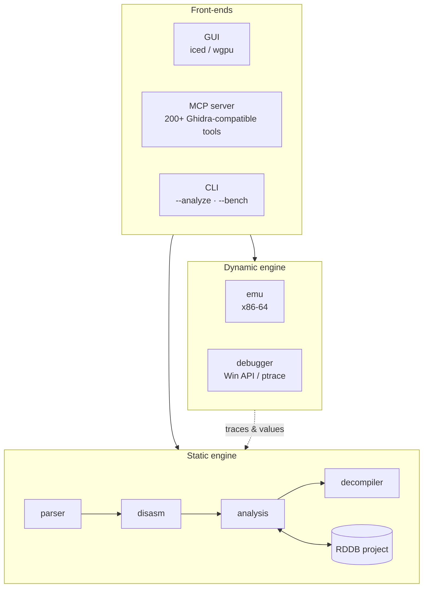

<div align="center">

<!--  -->

# Rust Debugger

### Ghidra / IDA-style reverse engineering — written in Rust

Static analysis, pcode decompilation, live debugging and an x86-64 emulator<br/>
in one fast, self-contained workbench — with a GPU-accelerated GUI<br/>
and a **Ghidra-compatible MCP server** for AI agents.

<br/>

[](LICENSE)
[](https://www.rust-lang.org/)
[](#requirements)
[](#mcp-server-for-ai-agents)
[](#)

[](https://github.com/jaszkus/rust-debugger/stargazers)
[](https://github.com/jaszkus/rust-debugger/issues)
[](#contributing)
[](https://github.com/jaszkus/rust-debugger/commits)

<br/>

[**Features**](#features) ·
[**Quick start**](#quick-start) ·
[**CLI**](#command-line) ·
[**MCP server**](#mcp-server-for-ai-agents) ·
[**Architecture**](#architecture) ·
[**Contributing**](#contributing)

</div>

<br/>

> [!WARNING]
> **Under active development (`0.3.0`).** Features, APIs and project-file formats may change.
> **I'm actively looking for contributors** — see [Contributing](#contributing).

<!--
   ADD A SCREENSHOT OR GIF HERE — it's the single biggest boost for a README.
  <p align="center">
    
  </p>
-->

---

## Why Rust Debugger?

| | |
| --- | --- |
|  **All-in-one** | Loader, disassembler, analyzer, decompiler, emulator and debugger in a single native binary. |
|  **Built for AI agents** | 200+ **Ghidra-compatible** MCP tool names — existing Ghidra-MCP clients and prompts work out of the box. |
|  **Fast & headless-friendly** | Batch `--analyze` and `--serve` modes need no GPU; analysis results are cached in compressed project files. |
|  **Modern GUI** | GPU-accelerated front-end on `iced` / `wgpu` (Vulkan, DX12 or Metal). |
|  **Static + dynamic** | Go from disassembly to decompiled C-like code, then step through it live or dry-run it in the emulator. |

### At a glance

| Formats | Architectures | Debugging | Platforms | MCP tools |
| :---: | :---: | :---: | :---: | :---: |
| PE · ELF · Mach-O · .NET · minidump · map | x86 · x86-64 · ARM64 | Win32 Debug API · `ptrace` | Windows · Linux | **200+** |

---

## Features

<table>
<tr>
<td width="50%" valign="top">

### Parsing & loading
- **PE, ELF, Mach-O**, **.NET** (CLR metadata), **minidump** and linker **map files**
- **DWARF** (via `gimli`) and **PDB** debug info
- C++ / Rust symbol **demangling**
- RTTI scan, resources, imports / exports, sections

</td>
<td width="50%" valign="top">

### Disassembly
- **x86 / x86-64** via [`iced-x86`](https://github.com/icedland/iced)
- **ARM64** via [`yaxpeax-arm`](https://github.com/iximeow/yaxpeax-arm)
- Built-in **x86 assembler / encoder** used for patching

</td>
</tr>
<tr>
<td width="50%" valign="top">

### Analysis pipeline
- Function detection (entries, thunks, call / jump targets) and **FID signatures**
- **CFG**, constant propagation, noreturn inference, stack / unwind and variable recovery
- Cross-references, import xrefs, **string extraction** with an n-gram classification model
- Detection passes: **packers, anti-debug, obfuscation, crypto**, .NET, Go, ObjC

</td>
<td width="50%" valign="top">

### Decompiler
- x86-64 → **pcode** lifting
- Mini-**SSA** expression trees
- **C-like** output with recovered variables
- Real **PDB / DWARF** parameter types, function signatures and struct member names

</td>
</tr>
<tr>
<td width="50%" valign="top">

### Emulation & live debugging
- **x86-64 emulator** (ALU, flags, memory) for deobfuscation and dry-running functions
- Live debugging through **Windows Debug API / Linux `ptrace`**
- Breakpoints, stepping, registers & memory, threads, stack traces, **recorded traces**

</td>
<td width="50%" valign="top">

### Patching & projects
- Byte and **branch patching** with history and rebuild-after-patch
- **RDDB v7** project files — zstd-compressed analysis cache + annotations

</td>
</tr>
<tr>
<td colspan="2" valign="top">

### GUI
Listing · Hex · Decompiler · Pcode · CFG · Xrefs · Strings · Symbols · Stack · Sections · Imports · Resources · Patches · Debug · Live

</td>
</tr>
</table>

---

## Requirements

- **Rust** stable toolchain (edition 2024, rustc ≥ 1.88)
- **Windows 10+** or **Linux** (Wayland / X11)
- A GPU with **Vulkan, DX12 or Metal** support for the GUI

> [!TIP]
> Headless `--serve` and `--analyze` runs need **no GPU** — perfect for servers, CI and containers.

---

## Quick start

```sh
git clone https://github.com/jaszkus/rust-debugger.git
cd rust-debugger
cargo build --release
```

The binary lands in `target/release/rust-debugger`.

```sh
rust-debugger                 # open an empty workbench
rust-debugger sample.exe      # open a binary straight away
```

---

## Command line

| Command | Description |
| --- | --- |
| `rust-debugger [file]` | Launch the GUI, optionally preloading a file |
| `rust-debugger --serve [port] [file]` | Headless MCP server (alias `--headless`). Default port `7777`, `0` picks a free one |
| `rust-debugger --analyze <file> [--fresh]` | Batch parse + disasm + analyze and print a JSON summary (RDDB-cached; `--fresh` ignores the cache) |
| `rust-debugger --bench <file> [--parse-only]` | Time the parse / disasm / analysis phases |
| `rust-debugger --version`, `--help` | Version / usage |

<details>
<summary><b>Environment variables & exit codes</b></summary>

<br/>

| Variable | Purpose |
| --- | --- |
| `RD_MAX_DECOMP` | `--analyze` sets it to `0` unless it is already set |
| `RUST_DEBUGGER_TOKEN` | Enables bearer-token auth for the MCP server |

| Exit code | Meaning |
| :---: | --- |
| `0` | OK |
| `1` | Runtime failure |
| `2` | Usage error |

</details>

---

## MCP server (for AI agents)

Rust Debugger speaks **JSON-RPC over HTTP** on `127.0.0.1` and exposes **200+ Ghidra-compatible tool names**, so
existing Ghidra-MCP clients and prompts work without changes.

```sh
rust-debugger --serve 7777                         # → http://127.0.0.1:7777/mcp
RUST_DEBUGGER_TOKEN=secret rust-debugger --serve   # require a bearer token
```

<details open>
<summary><b>Example MCP client configuration</b> (opencode.json / any MCP client)</summary>

```json
{
  "mcp": {
    "rust-debugger": {
      "type": "remote",
      "url": "http://127.0.0.1:7777/mcp",
      "headers": {
        "Authorization": "Bearer ${RUST_DEBUGGER_TOKEN}"
      }
    }
  }
}
```

</details>

> [!NOTE]
> The server listens on **localhost only**. Set `RUST_DEBUGGER_TOKEN` if other users or processes share the machine.

<details>
<summary><b>Full tool reference — 237 tools</b></summary>

<br/>

| Tool | Description |
| --- | --- |
| `search_tools` | Find tools by keywords/category (e.g. 'entropy', 'xor decrypt', category=patching). Empty query lists categories. Returns names, params, required args, async eligibility; include_schema=true attaches full inputSchema. |
| `get_metadata` | Get binary metadata: format, arch, entry point, file path |
| `get_function_count` | Return total number of detected functions |
| `get_entry_points` | List binary entry point addresses |
| `run_analysis` | Run auto-analysis and WAIT for the fresh result (blocking; timeout_ms default 600000, 5000..3600000). Use reanalyze for the old fire-and-forget queue. |
| `get_analysis_status` | Get current analysis progress / status |
| `int_convert` | Convert integer between formats (dec/hex/bin/bytes/ascii) |
| `list_functions` | List functions paginated with optional filter (name or hex address, '0x' optional). limit 1..1000: above is clamped (see 'warnings'), below is rejected |
| `lookup_function` | Lookup a function by address (hex) or name |
| `decompile_function` | Get pseudocode for a function at the given address |
| `disassemble_function` | Get full disassembly listing for a function |
| `get_function_callers` | Get functions that call the given address |
| `get_function_callees` | Get functions called by the given address |
| `get_function_pcode` | Get PCode IR for a function |
| `get_stack_frame` | Get stack frame variables (locals/params) for a function |
| `get_xrefs_to` | Get cross-references targeting an address |
| `get_xrefs_from` | Get cross-references originating from an address |
| `get_bytes` | Read raw bytes from a virtual address (hex string output). size 1..4096 per call; larger requests are clamped and flagged with truncated/warnings/next_address |
| `get_string` | Read a null-terminated string from a virtual address |
| `get_int` | Read an integer (u8/u16/u32/u64/i*) at a virtual address |
| `list_strings` | List extracted strings (paginated, filter, encoding). limit 1..5000 and a response-size budget per page: follow next_offset while has_more is true |
| `list_imports` | List imported symbols (paginated) |
| `list_exports` | List exported symbols (paginated) |
| `list_symbols` | List all symbols (paginated) |
| `list_sections` | List binary sections |
| `list_relocations` | List base/dynamic relocations (PE BaseReloc, ELF rela, PLT artificial) |
| `search_functions` | Search functions by name substring or hex address |
| `search_strings` | Search strings by substring |
| `search_bytes` | Search for a hex byte pattern ('??' = any byte) in binary data. Paged: has_more / next_offset tell whether the list is complete; pass offset to continue |
| `set_comment` | Set / update a user comment at an address (kind: eol\|pre\|post\|plate\|repeatable) |
| `delete_comment` | Delete the user comment at an address (optional kind) |
| `list_comments` | List all user comments (all kinds) |
| `set_bookmark` | Add a bookmark at an address (kind: note\|info\|error\|analysis) |
| `set_plan` | Publish the agent plan shown in the AI Live card (steps + in-progress index) |
| `list_bookmarks` | List all bookmarks |
| `delete_bookmark` | Delete bookmark at an address |
| `rename_function` | Rename a detected function |
| `undo_annotation` | Undo the last annotation edit (comment/bookmark/label/rename/tag) |
| `redo_annotation` | Redo the last undone annotation edit |
| `get_function_at` | Find function containing the given address |
| `get_section_at` | Find section containing the given address |
| `address_info` | All info about an address: section, function, basic block, instruction, string, symbol, xrefs, comment |
| `get_basic_block_at` | Find the basic block containing the given address |
| `list_basic_blocks` | List all basic blocks of a function with successors/predecessors |
| `get_function_summary` | Comprehensive one-shot summary of a function: signature, callers/callees, used imports, used strings, preview |
| `get_annotated_disasm` | Disassembly of a function with inline annotations: comments, call targets, string refs, xrefs |
| `find_imports_called_by` | List Win32/POSIX imports called by a function (direct or via stub) |
| `find_strings_referenced_by` | List strings referenced by a function |
| `find_users_of_import` | List functions that use a given import (by name, e.g. 'CreateFileW' or 'KERNEL32.dll!CreateFileW') |
| `get_call_tree` | Get call tree (BFS through callees) from a function up to max_depth |
| `find_callers_chain` | Get layered list of callers up to max_depth |
| `find_recursive_functions` | List functions that call themselves |
| `find_leaf_functions` | List functions that don't call any other function |
| `find_root_functions` | List functions that are never called by any other function |
| `get_function_hash` | Get dual FNV-1a hashes (full masked + value-sensitive specific) of a function body |
| `find_similar_functions` | Find groups of functions with identical masked code shape |
| `fid_ingest_library` | Ingest named functions of the current analysis as a FunctionID library (persists in session, merges into analysis) |
| `fid_export_db` | Export the session FunctionID library to a .fidb JSON file |
| `fid_import_db` | Import a .fidb JSON library file into the session FunctionID DB |
| `fid_list` | List session FunctionID signatures (filter by name/library substring) |
| `list_stubs` | List detected import thunks / stub functions |
| `list_switch_tables` | List detected switch/jump tables |
| `find_format_strings` | List strings containing C printf-style format specifiers (%s, %d, etc.) |
| `search_in_decompiled` | Search regex/substring across all decompiled pseudocode |
| `search_instruction_pattern` | Find sequences of instructions matching a pattern of mnemonics (e.g. 'push;mov;call'). Paged: has_more / next_offset |
| `disassemble_range` | Disassemble N instructions starting at an address (or up to end_address). No analysis required. |
| `disassemble_bytes` | Disassemble a hex byte string at an arbitrary base address. No binary required. |
| `find_immediate_refs` | Scan sections for raw immediate references (32-bit and 64-bit LE) to an address. Useful when xref analysis hasn't run. |
| `cancel_analysis` | Cancel a stuck analysis run and free the progress slot. The background thread silently discards its result. |
| `find_callsites_to_import` | Ghidra-style: scan the binary for every direct call/jump to an imported function (by name like 'MessageBoxW' or 'USER32.dll!MessageBoxW') and every call to its import thunk |
| `detect_protections` | Run all detectors at once and return a structured protection report (anti-debug, anti-VM, packers, obfuscation, .NET, crypto) |
| `detect_anti_debug` | Anti-debug imports, strings, INT 2D / RDTSC / SIDT, PEB reads via fs:[30]/gs:[60] |
| `detect_anti_vm` | Anti-VM strings (VBox/VMware/QEMU), CPUID, VMware backdoor port 0x5658 |
| `detect_packers` | Known packer section names (UPX/ASPack/VMProtect/Themida/...), entropy, tiny IAT |
| `detect_obfuscation` | Indirect jumps/calls, jmp $+2 junk, prefix soup, opaque predicates |
| `detect_crypto` | Common crypto init constants (MD5/SHA1/SHA256/AES Rcon) |
| `is_dotnet_assembly` | Quick yes/no — is the loaded PE a managed .NET assembly? |
| `dotnet_info` | CLR runtime version, COR20 flags, entry-point token, stream layout, table/type/method counts |
| `list_dotnet_types` | List TypeDef rows (paginated, optional name filter) |
| `list_dotnet_methods` | List MethodDef rows with owner type (paginated, optional name filter) |
| `list_dotnet_member_refs` | List MemberRef rows (external calls like System.Console::WriteLine) with parent scope |
| `resolve_dotnet_token` | Resolve a metadata token (e.g. 0x0A000003) to Parent::Name |
| `get_pe_info` | PE/DLL header info: image_base, is_dll, COFF + DLL characteristics with decoded flag names (CFG, DEP, ASLR, ...) |
| `list_exports_full` | List exports with ordinal, RVA, address, and forwarder string (paginated, filter, only_forwarders) |
| `lookup_export` | Lookup an export by name OR ordinal |
| `list_imported_libraries` | Group imports by DLL (kernel32.dll, ntdll.dll, etc.) |
| `dll_export_summary` | Counts of named/ordinal-only/forwarder exports — useful for stub-DLL fingerprinting |
| `section_entropy` | Per-section entropy with verdict (packed_or_encrypted / compressed / code / structured / padding) |
| `find_pe_headers` | Scan whole binary for embedded PE headers (MZ + PE\\0\\0). Reveals nested loaders / overlays |
| `find_xor_loops` | Heuristic scan for XOR-based decryption stubs: `xor mem, ...` followed by `inc idx; backward branch` |
| `find_aes_rcon_table` | Locate the canonical AES Rcon table (01 02 04 08 10 20 40 80 1B 36) — marks AES key expansion |
| `dump_section` | Dump a section to a file by name |
| `dump_range` | Dump a virtual address range to a file |
| `dump_full_binary` | Dump entire current (possibly patched) binary data to a file |
| `load_binary` | Parse and load a PE/ELF/Mach-O file from disk as the current binary |
| `load_memory_dump` | Load a raw memory dump file as a new binary (replaces current) |
| `load_map_file` | Import symbols from an MSVC .map file into the loaded binary (args: path, optional base_offset hex added to every address) |
| `patch_bytes` | Patch raw bytes at a virtual address (hex string; 'bytes' or alias 'hex'). Records the patch for undo/list. Drops the analysis by default (analysis_invalidated in the response; invalidate_analysis=false keeps it) |
| `nop_range` | Replace a byte range with x86 NOPs (0x90) |
| `fill_bytes` | Fill a virtual address range with a single byte value (e.g. 0xCC for INT3) |
| `fill_pattern` | Fill a virtual address range with a repeating hex pattern |
| `patch_string` | Write an ASCII/UTF-8 string at a virtual address (optionally null-terminated) |
| `patch_wide_string` | Write a UTF-16LE string at a virtual address (optionally null-terminated) |
| `patch_int` | Write an integer (u8/u16/u32/u64/i*) at a virtual address (LE/BE) |
| `copy_bytes` | Copy `size` bytes from src_address to dst_address within the binary |
| `search_and_replace_bytes` | Find a hex pattern across (optionally a single section) and replace each match with a same-length pattern |
| `patch_nop_instruction` | Replace one or more whole instructions starting at address with NOPs (uses disassembly to size them) |
| `patch_call_to_nop` | Replace the call instruction at address with NOPs (auto-sized) |
| `patch_jcc_to_nop` | Replace the conditional jump at address with NOPs (auto-sized) |
| `patch_jcc_invert` | Invert the condition of a Jcc at address (je↔jne, jl↔jge, etc.) — short or near |
| `patch_jcc_to_jmp` | Convert the conditional jump at address into an unconditional jump (preserves target) |
| `patch_jmp_to_address` | Write `jmp rel32` at address jumping to target (5 bytes; rel must fit in 32 bits) |
| `patch_function_to_ret` | Replace function entry with a single 0xC3 (`ret`) so the function does nothing |
| `patch_return_value` | Rewrite function entry as `xor eax,eax;ret` (value=0) or `mov eax,imm32;ret` (i32 fits) |
| `list_patches` | List every patch recorded in this session (offset, vaddr, original, new, description) |
| `get_patch_diff` | Get all patches as an offset-sorted before/after diff |
| `undo_last_patch` | Undo (revert) the most recently applied patch |
| `undo_patch_at` | Undo the most recent patch covering a given virtual address |
| `revert_all_patches` | Revert all patches and clear the history |
| `clear_patch_history` | Clear the patch history without reverting (keeps current binary state) |
| `export_patches` | Export the patch list to a JSON file (replayable via import_patches) |
| `import_patches` | Apply patches from a JSON file produced by export_patches |
| `diff_with_file` | Byte-by-byte compare current binary data with a file on disk |
| `save_patched_binary` | Write the (possibly patched) binary data to a new file |
| `get_debugger_status` | Get current debugger status, registers, breakpoint count, recent events |
| `debugger_start` | Start debugging the currently loaded binary (queues request) |
| `debugger_step_into` | Single-step into (queues request) |
| `debugger_step_over` | Step over (queues request) |
| `debugger_continue` | Continue execution (queues request) |
| `debugger_pause` | Suspend a running target for inspection (SIGSTOP/DebugBreakProcess); resume with debugger_continue |
| `debugger_stop` | Terminate debug session (queues request) |
| `add_breakpoint` | Add a breakpoint at an address |
| `remove_breakpoint` | Remove a breakpoint at an address |
| `list_breakpoints` | List all breakpoints |
| `list_watchpoints` | List hardware watchpoints (read/write/access + hw exec) |
| `read_process_memory` | Read live process memory (debugger must be attached). Returns hex+ASCII of the requested range. |
| `write_process_memory` | Write live process memory (debugger must be attached). Hex bytes payload. |
| `list_memory_regions` | Walk every committed region in the live process (VirtualQueryEx). Optional only_executable / only_writable filters. |
| `list_modules` | List every loaded module in the target process (DLLs + EXE) with runtime base + size. |
| `list_threads` | List thread IDs in the target process. |
| `disassemble_process_memory` | Read N instructions from the live process at a runtime address. Use this to see *decrypted* code on the fly. |
| `search_process_memory` | Scan the live process memory for a pattern. Hex bytes (default) or ASCII string with `s:` prefix. |
| `dump_process_region` | Dump [address, address+size] of live process memory to a file. |
| `set_hardware_breakpoint` | Arm a DR0..DR3 hardware breakpoint (kind: execute\|write\|rw). Per-thread. |
| `clear_hardware_breakpoint` | Clear a DR0..DR3 hardware breakpoint slot. |
| `arm_software_breakpoint` | Write 0xCC at the given address in the live process and remember the original byte. |
| `run_until_address` | Arm an INT3 at address, continue, and poll until the BP is hit. Returns registers at hit. |
| `start_trace` | Start single-step trace recording. Subsequent BP/SS hits append to a ring buffer of size `max`. |
| `stop_trace` | Stop trace recording. |
| `read_trace` | Read the recorded trace (rip/rax/rcx/rdx/rsp/t per entry). |
| `save_trace` | Save the recorded trace to a JSON file (Ghidra SaveTraceTask equivalent) |
| `load_trace` | Load a saved trace file back into the buffer (time-ordered) |
| `set_debug_options` | Toggle forward_exceptions (DBG_EXCEPTION_NOT_HANDLED for SEH/VEH) and auto_continue_after_bp. |
| `set_exception_policy` | Per-exception-code policy override: forward/swallow/pause/clear. Wins over the global forward_exceptions flag. |
| `scan_rtti` | C++ RTTI scanner (MSVC + Itanium fallback): TypeDescriptors/COLs/vftables/first vfunc per class. |
| `emu_run_function` | Concretely execute a function on the p-code emulator (no live process): pass integer args (rdi,rsi,...), get rax, end reason, steps and memory writes |
| `debugger_attach` | Attach the debugger to an already-running process by PID. Non-destructive on detach. |
| `debugger_detach` | Detach from the target without killing it. |
| `get_current_program_info` | Get current program info: name, path, language, image base, entry point, counts |
| `reanalyze` | Trigger full auto-analysis (alias of run_analysis) |
| `save_program` | Write the (possibly patched) binary to a file |
| `import_file` | Import a binary file from disk and load it (alias of load_binary) |
| `list_data_items` | List defined data: strings in non-executable sections (paginated, filter) |
| `list_globals` | List global symbols with section + type info (paginated) |
| `list_namespaces` | List C++ namespaces derived from demangled function names |
| `list_classes` | List C++ classes derived from demangled function names |
| `list_calling_conventions` | List known calling conventions |
| `list_valid_data_types` | List built-in data types |
| `get_function_labels` | List labels (user + symbol) inside a function |
| `create_label` | Create an in-memory user label at an address |
| `delete_label` | Delete a user label at an address |
| `list_labels` | List all user-defined labels (with source: user\|analysis) |
| `tag_function` | Tag a function for triage (e.g. crypto, network, reviewed) |
| `untag_function` | Remove a tag from a function |
| `list_function_tags` | List function tags (all, or for one address) |
| `label_strings` | Apply default s_xxx labels to all strings missing a user label |
| `search_instructions` | Search instructions by mnemonic and/or operand substring |
| `search_functions_enhanced` | Advanced function search: name + size range + caller/callee counts |
| `search_byte_patterns` | Search for byte patterns (alias of search_bytes) |
| `force_decompile` | Force fresh decompilation of a function |
| `get_function_xrefs` | All xrefs into and out of a function |
| `get_bulk_xrefs` | Get xrefs to a list of addresses in one call |
| `add_memory_reference` | Create a user-defined memory reference (in-memory only) |
| `remove_reference` | Remove a user-defined memory reference |
| `list_memory_references` | List user-defined memory references |
| `batch_set_comments` | Set multiple comments atomically: [{address, kind, text}] |
| `analyze_call_graph` | Call graph statistics: roots, leaves, indegree/outdegree distribution |
| `analyze_control_flow` | CFG statistics for a function: blocks, edges, branch points |
| `find_code_gaps` | Find gaps of undefined bytes between functions in executable sections |
| `find_next_undefined_function` | Find the first undefined byte region after an address |
| `create_function` | Define a function at an address (Ghidra createFunction; UserDefined source, persists in .rdb v4) |
| `delete_function` | Delete the function starting at an address |
| `resolve_thunk` | Walk a thunk chain to its ultimate destination (Ghidra getThunkedFunction; import thunks show DLL!Name) |
| `inspect_memory_content` | Read memory with heuristic type guessing (string/pointer/data) |
| `read_memory` | Read raw memory at an address (alias of get_bytes) |
| `get_assembly_context` | Disassemble N instructions before/after an address |
| `diff_functions` | Diff two functions by normalized mnemonic sequence |
| `get_function_signature` | Get first N bytes of a function as a signature + FNV-1a hash |
| `check_connection` | Health check: is the MCP server connected and which program is loaded |
| `health` | Server health: binary/analysis/debugger state |
| `get_version` | Get server version and feature list |
| `debugger_stack_trace` | Walk the EBP frame chain of the attached process and resolve return addresses |
| `list_data_types` | List all data types in the type manager (id, name, size, C decl) |
| `get_data_type` | Get one data type by name (id, size, C declaration) |
| `create_struct` | Create a struct type |
| `create_union` | Create a union type |
| `create_enum` | Create an enum type (optional underlying type) |
| `create_typedef` | Create a typedef of an existing type |
| `create_pointer_type` | Create a pointer-to-type (deduped by target) |
| `create_array_type` | Create an array type [count] of an element type |
| `create_function_signature` | Create a function signature type: return_type, params [{name,type}], calling_convention, varargs |
| `add_struct_field` | Add a field to a struct/union (auto-offset after the last field, or explicit offset) |
| `remove_struct_field` | Remove a field from a struct/union by name |
| `add_enum_variant` | Add a named value to an enum |
| `rename_data_type` | Rename a data type |
| `delete_data_type` | Delete a user data type (fails if referenced) |
| `apply_data_type` | Ghidra setDataType: define data of a type at an address |
| `get_data_type_at` | Get the data type applied at an address |
| `list_applied_types` | List all address->type definitions |
| `export_types` | Export the type manager as JSON (reimportable) |
| `import_types` | Import types from a JSON doc (inline 'types' array) or a file path |
| `import_dwarf_types` | Import DWARF types from the loaded ELF's .debug_info into the DataTypeManager (structs/unions/enums/typedefs with members and layouts) |
| `import_pdb` | Import types from a PDB file (MSVC): path, or default <binary>.pdb next to the loaded PE. Classes/unions/enums with fields, enum values |
| `list_type_archives` | List built-in type archives (win32/crt/libc — Ghidra .gdt equivalent) |
| `load_type_archive` | Seed well-known OS/CRT types from a built-in archive (idempotent) |
| `assemble` | Assemble a single instruction to bytes (mov/call/jmp/jcc/push/pop/xor/add/sub/cmp/test/lea/nop/ret/int3/...) |
| `assemble_snippet` | Assemble multiple lines (one instruction per line) at an address |
| `patch_asm` | Assemble an instruction at an address and patch it into the binary (records patch, invalidates analysis) |
| `list_asm_mnemonics` | List mnemonics supported by the built-in assembler |
| `open_program` | Open a binary from disk as a new program (saves the current one as a slot) |
| `close_program` | Close an open program by name (switches away if it's the current one) |
| `list_open_programs` | List all open programs (multi-program model) |
| `switch_program` | Switch the current program to an already-open one (by name) |
| `get_binary_overview` | One-shot binary overview: format, arch, entry, sections, import summary, exports, function count, protection report counts. Replaces 5+ separate calls. |
| `get_call_context` | One-shot call context for an address: containing function + decompilation + callers + callees + imports called + strings referenced. |
| `run_async` | Run an allowlisted long scan in a background thread (max 4 concurrent, timeout_ms default 120s) and return a job_id. Poll with poll_job. Eligible: detect_*, search_*, find_*, list_strings, section_entropy, get_binary_overview, get_call_context, analyze_call_graph, scan_rtti and more - search_tools marks every eligible tool with async_eligible=true. |
| `poll_job` | Poll a background job (timeout_ms enforced). Returns the tool result when done; consumes the job slot. |

</details>

---

## Use as a library

The crate is also a library (`rust_debugger::…`):

```toml
# Cargo.toml
[dependencies]
rust-debugger = { git = "https://github.com/jaszkus/rust-debugger" }
```

```rust
use rust_debugger::{disasm, parser};

let bin = parser::parse_file(std::path::Path::new("sample.exe"))?;
let listing = disasm::disassemble_binary(&bin)?;
```

---

## Architecture



<details>
<summary><b> Project layout</b></summary>

```
src/
  analysis/    protections, decompiler (pcode/printing/structure), flow, symbols, xrefs, pipeline
  asm/         x86 assembler/encoder
  debugger/    live debugging (windows / linux)
  disasm/      x86-64 + ARM64 disassembly
  emu/         x86-64 emulator (alu / config / exec / mem / regs)
  gui/         iced GUI (app, state, theme, views, widgets)
  mcp/         MCP server, protocol and tool registry
  parser/      binary formats (pe/elf/macho/dotnet/minidump/mapfile), strings, model
  project/     RDDB project files (snapshot, codecs)
  type_system/ data-type archives (win32/crt/libc) and codecs
  tests/       unit / full / parity / fuzz / mcp suites
  util/        shared helpers
data/          string classification model (see data/README.md)
assets/        GUI fonts and icon
```

</details>

---

## Development

```sh
cargo test                     # unit + integration suites
cargo check --all-targets      # quick compile check
```

---

## Contributing

The project is in active development and **contributors are very welcome** — this is a great moment to get
involved, whatever your experience level.

| Way to help | How |
| --- | --- |
| **Bugs & feature ideas** | Open an [issue](https://github.com/jaszkus/rust-debugger/issues) |
| **Pull requests** | Fixes, new analysis passes, format parsers, MCP tools, GUI polish, docs |
| **Testing** | Run it on your own binaries (PE / ELF / Mach-O / .NET) and report what breaks |
| **Documentation** | Anything unclear in the README or the code is worth a fix |

> **Not sure where to start?** Open an issue and I'll help you get oriented.

Details on dev setup, code layout and the PR process: [**CONTRIBUTING.md**](CONTRIBUTING.md) ·
Security reports: [**SECURITY.md**](SECURITY.md)

<a href="https://github.com/jaszkus/rust-debugger/graphs/contributors">
  
</a>

---

## Built with & acknowledgements

[`iced`](https://github.com/iced-rs/iced) / [`wgpu`](https://wgpu.rs/) ·
[`iced-x86`](https://github.com/icedland/iced) ·
[`yaxpeax-arm`](https://github.com/iximeow/yaxpeax-arm) ·
[`gimli`](https://github.com/gimli-rs/gimli) ·
[Ghidra](https://github.com/NationalSecurityAgency/ghidra) (string model & MCP tool naming inspiration)

---

## License

Licensed under the **Apache License 2.0** — see [LICENSE](LICENSE).

- `data/StringModel.sng` is an unmodified copy of Ghidra's string n-gram model
  (`Ghidra/Features/Base/data/stringngrams/StringModel.sng`, © National Security Agency, Apache-2.0).
  `data/StringModelLLR.bin` is a precomputed table derived from it. See [NOTICE](NOTICE) and [data/README.md](data/README.md).
- Third-party Rust crates keep their own licenses.

> [!IMPORTANT]
> Rust Debugger is intended for **security research, malware analysis, interoperability and education**.
> Use it only on software you are authorized to analyze.

---

<div align="center">

**If you find Rust Debugger useful, consider giving it a star — it really helps the project grow!**

[](https://star-history.com/#jaszkus/rust-debugger&Date)

</div>
